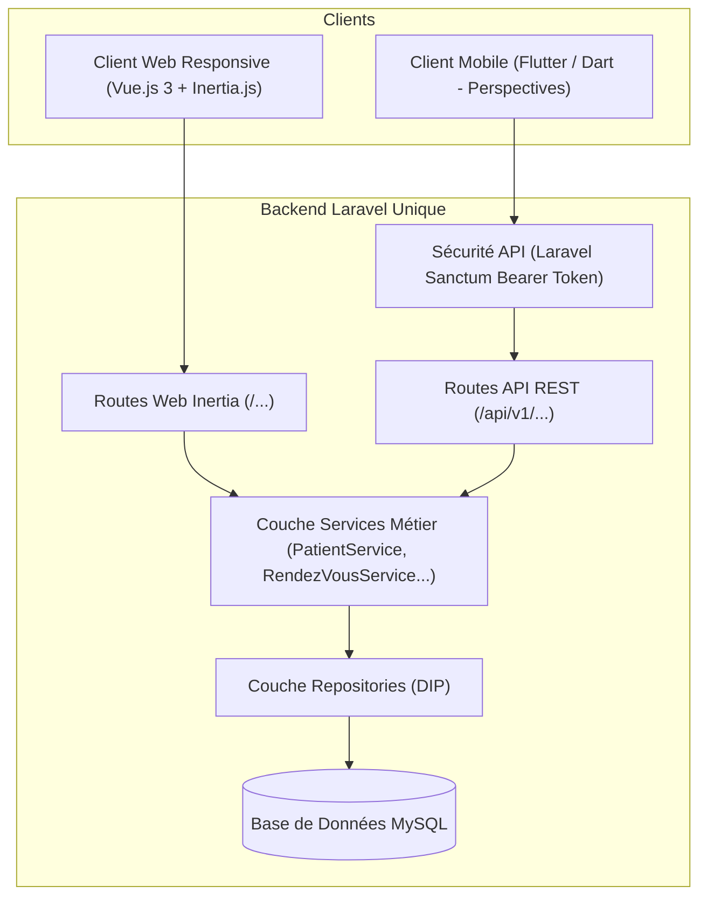

# Étude d'Architecture : Perspectives de l'Application Mobile Flutter

**Mémoire :** Étude et mise en place d'un Système de Gestion de Dossier Médical Électronique (DME)  
**Étudiante :** Binetou (IG3 - Licence en Gestion des Systèmes d'Information)  
**Encadreur :** M. Ahmed Ben Sidy Bouya Seye  

Ce document constitue le support de rédaction du chapitre **« Perspectives : Application Mobile Flutter »** exigé par le document de cadrage du mémoire.

---

## 1. Contexte & Cadrage Académique

Conformément aux orientations de cadrage (Section 1.4 & Section 2 du plan directeur) :
- Le développement de l'application mobile Flutter n'est pas requis pour la validité du diplôme de Licence.
- En revanche, sa **conception architecturale rigoureuse** est un critère valorisé démontrant la vision d'évolutivité et le respect du principe **OCP (Open/Closed Principle)**.

---

## 2. Architecture Technique Envisagée

Inertia.js étant conçu pour relier Laravel à un frontend Web (Vue.js), un client mobile natif (Flutter) ne peut pas consommer directement des pages Inertia.  
La solution architecturale consiste à exposer une couche d'**API RESTful JSON** sécurisée par jetons d'accès.



### 2.1 Réutilisation Intégrale de la Logique Métier (Bénéfice SOLID)
Grâce à l'architecture en couches mise en place :
1. **Zéro réécriture de logique :** Les contrôleurs API mobiles appelleront exactement les mêmes **Services** (`PatientService`, `RendezVousService`, `DossierMedicalService`).
2. **Mêmes DTOs et Builders :** Les données entrantes seront validées par les mêmes DTOs immuables.
3. **Mêmes Policies :** Les règles d'accès au secret médical s'appliquent identiquement au mobile.

---

## 3. Spécifications de l'API REST Mobile (Laravel Sanctum)

### 3.1 Authentification par Jetons Révoquables (Bearer Token)
- Endpoint : `POST /api/v1/auth/login`
- Réponse JSON :
  ```json
  {
    "token": "1|qX8zL9...sanctum_bearer_token",
    "user": {
      "id": 4,
      "name": "Fatou Diop",
      "email": "patient@dme.sn",
      "role": "patient"
    }
  }
  ```

### 3.2 Écrans Prioritaires Dédiés au Patient sur l'Application Mobile
1. **Écran de Connexion & Empreinte Biométrique :** Authentification rapide par Face ID / Fingerprint via `local_auth` Flutter.
2. **Écran « Mes Rendez-vous » :**
   - Consultation des RDV à venir et passés (`GET /api/v1/patient/rendez-vous`).
   - Prise de nouveau rendez-vous avec sélecteur de créneaux (`POST /api/v1/patient/rendez-vous`).
   - Notification push de rappel la veille du rendez-vous (Firebase Cloud Messaging).
3. **Écran « Mon Dossier Médical » :**
   - Synthèse des antécédents et constantes vitales avec graphiques d'évolution (tension, IMC).
   - Historique des ordonnances avec visualisation PDF mobile.

---

## 4. Contraintes Techniques & Recommandations

1. **Sécurité des échanges :** Chiffrement obligatoire **HTTPS / TLS 1.3** et épinglage de certificat (*Certificate Pinning*) pour se prémunir des attaques de l'homme du milieu (MitM).
2. **Mode Hors-Ligne (Offline First) :** Utilisation d'une base locale SQLite ou Hive sur le smartphone pour permettre au patient de consulter son ordonnance et ses antécédents même sans connexion Internet.
3. **Interopérabilité future (HL7 FHIR) :** Standardisation des réponses JSON selon le standard de santé FHIR (Ressources `Patient`, `Observation`, `Appointment`).
