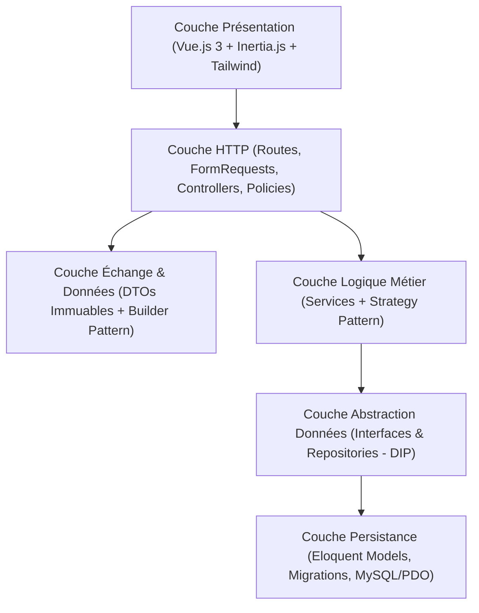

# Plan Directeur de Réalisation – Dossier Médical Électronique (DME)

**Projet :** Étude et mise en place d'un Système de Gestion de Dossier Médical Électronique  
**Étudiante :** Binetou (IG3 – Licence en Gestion des Systèmes d'Information)  
**Encadreur :** M. Ahmed Ben Sidy Bouya Seye (Sujet n° 5)  
**Stack :** Laravel 12/13 (PHP 8.3 OOP), Vue.js 3 (Composition API / TypeScript), Inertia.js, Tailwind CSS / Shadcn, MySQL / SQLite, Pest / PHPUnit  

---

## 1. Vision et Alignement Académique & Technique

Ce plan de réalisation opérationnel fait le pont direct entre :
1. **Les exigences académiques du professeur** (14 semaines, modélisation UML, sécurité et secret médical, traçabilité CDP Sénégal, 6 modules fonctionnels, scénario de démonstration).
2. **L'excellence en génie logiciel** : Architecture en couches (Clean / Hexagonal-inspired), respect strict des principes **SOLID** et implémentation concrète des **Design Patterns** (GoF et Enterprise Patterns).
3. **Le versionnage rigoureux sous Git/GitHub** : Chaque étape fait l'objet d'une branche dédiée `feat/...`, de tests unitaires/fonctionnels et d'un commit conventionnel pushé sur le dépôt distant.



---

## 2. Matrice d'Application des Principes SOLID & Design Patterns

| Principe / Pattern | Implémentation dans le DME | Bénéfice Mémoire & Code |
| :--- | :--- | :--- |
| **SRP** (*Single Responsibility Principle*) | Découpage net : FormRequest (validation), Controller (orchestration HTTP), Service (règles métier), Repository (requêtage), DTO (transport). | Contrôleurs légers (*Skinny Controllers*), tests ciblés. |
| **OCP** (*Open/Closed Principle*) | Extension sans modification via interfaces (ex: formats d'export d'ordonnances, règles d'évaluation des constantes). | Facilite l'ajout futur de modules sans casser l'existant. |
| **LSP** (*Liskov Substitution Principle*) | Toutes les implémentations de repositories ou de builders peuvent se substituer à leurs contrats d'interface sans altérer le comportement. | Interchangeabilité des sources de données et mocks de test fiables. |
| **ISP** (*Interface Segregation Principle*) | Création d'interfaces fines et ciblées (`BuilderInterface`, `AuditLoggerInterface`, `RendezVousSearchInterface`) plutôt qu'une interface géante. | Pas de méthode superflue forcée sur les classes. |
| **DIP** (*Dependency Inversion Principle*) | Les Contrôleurs et Services dépendent d'abstractions (Interfaces/Contracts) injectées via le Container de services Laravel, jamais d'implémentations concrètes directes. | Découplage maximal, testabilité unitaire à 100%. |
| **Builder Pattern** (GoF Création) | `CreatePatientDTOBuilder`, `CreateRendezVousDTOBuilder`, `CreateConsultationDTOBuilder`, etc. | Construction pas à pas, lisible et validée des structures de données complexes. |
| **Repository Pattern** (Architecture) | `PatientRepositoryInterface` $\rightarrow$ `EloquentPatientRepository`, etc. | Encapsulation de l'accès aux données ; masque Eloquent/PDO derrière un contrat. |
| **Strategy Pattern** (GoF Comportement) | Stratégies de calcul des alertes sur constantes vitales (IMC, hypertension), stratégies d'annulation/report de rendez-vous. | Algorithmes interchangeables dynamiquement selon le contexte. |
| **Observer Pattern** (GoF Comportement) | `ConstanteObserver`, `OrdonnanceObserver`, `JournalAuditObserver`. | Réaction automatique aux événements du cycle de vie sans polluer la logique métier. |
| **Proxy / Policy Pattern** (Sécurité) | Laravel Policies (`DossierMedicalPolicy`, etc.) vérifiant le secret médical avant toute consultation. | Cloisonnement strict des rôles (Patient, Médecin, Secrétaire, Admin). |

---

## 3. Feuille de Route Opérationnelle & Versionnage GitHub

### ✅ Étape 1 : Socle de Base de Données, Modèles & Seeders
- **Branche Git :** `feat/01_initialisation-de-la-base-de-donner` (Fusionnée / Pushée)
- **Réalisations :**
  - 13 tables relationnelles créées (Users, Services, Médecins, Secrétaires, Patients, Dossiers, Constantes, RDV, Consultations, Ordonnances, Prescriptions, Documents, Audit).
  - Enums typés PHP 8.3 (`UserRole`, `AppointmentStatus`, `BloodGroup`, `AuditAction`).
  - Observers (`ConstanteObserver`, `OrdonnanceObserver`).
  - Seeders complets pour générer des données de test réalistes.

---

### ✅ Étape 2 : Data Transfer Objects (DTOs) & Builder Pattern
- **Branche Git :** `feat/02-Data-Transfere-object` (Pushée sur `origin/feat/02-Data-Transfere-object`)
- **Principes & Patterns :**
  - **SRP & DIP :** DTOs immuables (`readonly class`) avec contrats `BuilderInterface` et `DataTransferObjectInterface`.
  - **Builder Pattern :** 8 Builders pour créer les DTOs complexes en toute sécurité.
  - **Tests :** 50 assertions de tests unitaires Pest réussies (`tests/Unit/DTOs/DTOAndBuilderTest.php`).

---

### ✅ Étape 3 : Couche Repository & Contrats d'Interface (DIP & ISP)
- **Branche Git :** `feat/03-repositories-contracts` (Pushée sur `origin/feat/03-repositories-contracts`)
- **Principes & Patterns :**
  - **DIP (Dependency Inversion Principle) :** Injection automatique des abstractions via `RepositoryServiceProvider` lié dans `bootstrap/providers.php`.
  - **ISP (Interface Segregation Principle) :** Contrats fins et cohérents (`PatientRepositoryInterface`, `RendezVousRepositoryInterface`, `DossierMedicalRepositoryInterface`, `ConsultationRepositoryInterface`, `JournalAuditRepositoryInterface`, `MedecinRepositoryInterface`).
  - **LSP (Liskov Substitution Principle) :** Implémentations `BaseRepository` et spécialisées Eloquent substituables aux contrats.
  - **Tests :** 56 tests unitaires et d'intégration validés avec 231 assertions réussies (`tests/Feature/Repositories/RepositoryPatternTest.php`).

---

### ✅ Étape 4 : Couche Services Métier & Pattern Strategy (Logique Santé & SRP)
- **Branche Git :** `feat/04-service-layer-and-strategies` (Pushée sur `origin/feat/04-service-layer-and-strategies`)
- **Principes & Patterns :**
  - **SRP (Single Responsibility Principle) :** Services métier dédiés (`PatientService`, `RendezVousService`, `DossierMedicalService`, `ConsultationService`, `AuditService`).
  - **OCP (Open/Closed Principle) & Strategy Pattern :** Évaluation dynamique des alertes cliniques (`VitalsAlertManager`, `ImcAlertStrategy`, `BloodPressureAlertStrategy`, `GlycemiaAlertStrategy`, `HeartRateAlertStrategy`).
  - **DIP (Dependency Inversion Principle) :** Injection via `BusinessServiceProvider` des contrats d'interface de services.

---

### ✅ Étape 5 : Sécurité, Contrôle d'Accès & Traçabilité (Policies & Secret Médical)
- **Branche Git :** `feat/05-security-policies-and-audit` (Pushée sur `origin/feat/05-security-policies-and-audit`)
- **Principes & Patterns :**
  - **Proxy / Policy Pattern :** Règles d'autorisations strictes pour le secret médical (`DossierMedicalPolicy`, `RendezVousPolicy`, `ConsultationPolicy`, `PatientPolicy`, `JournalAuditPolicy`).
  - **Chain of Responsibility Pattern :** Middleware de filtrage par rôle `EnsureUserHasRole` (`role:admin,medecin,...`) avec traçabilité immédiate des violations d'accès (CDP Sénégal).
  - **Cloisonnement des rôles :** Un patient n'accède qu'à son propre dossier ; un médecin n'édite que ses consultations ; l'administrateur est isolé des données cliniques pures.

---

### ✅ Étape 6 : Form Requests, Contrôleurs Allégés & API Interne Inertia
- **Branche Git :** `feat/06-controllers-and-form-requests` (Pushée sur `origin/feat/06-controllers-and-form-requests`)
- **Principes & Patterns :**
  - **Skinny Controllers & SRP :** Contrôleurs légers (`PatientController`, `RendezVousController`, `DossierMedicalController`, `ConsultationController`, `AdminDashboardController`, `AuditController`, `UserController`).
  - **Adapter Pattern :** `FormRequests` stricts avec méthode adaptatrice `toDTO()` (`StorePatientRequest`, `StoreRendezVousRequest`, `StoreConstanteRequest`, `StoreConsultationRequest`, etc.).
  - **Routage RESTful sécurisé :** Routes web structurées par domaine fonctionnel et protégées par rôles.

---

### ✅ Étape 7 : Interface Utilisateur Vue.js 3 / Inertia.js (Modulaire & Responsive)
- **Branche Git :** `feat/07-vue-inertia-frontend` (Pushée sur `origin/feat/07-vue-inertia-frontend`)
- **Principes & Patterns :**
  - **Template Method & Composite UI :** Layout adaptatif selon le rôle de l'utilisateur (`AppSidebar` avec menus ciblés pour Patient, Médecin, Secrétaire, Administrateur).
  - **Couverture des 6 modules du mémoire :**
    - Patients (`Index`, `Create`, `Show`, `Edit`)
    - Rendez-vous (`Index`, `Create` avec détection de conflits)
    - Dossier Médical (`Show` avec constantes, alertes cliniques visuelles, antécédents, documents)
    - Consultations (`Create`, `Show`, `PrintOrdonnance` conforme)
    - Administration (`Dashboard` avec KPIs, `Audit` conforme CDP Sénégal, `Users` avec gestion des rôles)
  - **Compilation Vite :** 100% sans erreur (`✓ built in 9.18s`).

---

### ✅ Étape 8 : Scénario de Démonstration Clé en Main & Bonus Soutenance (+2 pts)
- **Branche Git :** `feat/08-demo-scenario` (Pushée sur `origin/feat/08-demo-scenario`)
- **Principes & Patterns :**
  - **Command Pattern :** Commande Artisan `php artisan dme:demo {--fresh}` réinitialisant et configurant le scénario de démo en 1 commande.
  - **Déroulé chronologique du scénario officiel (5 à 7 min) :**
    1. Patient : Fatou Diop (`patient@dme.sn`) $\rightarrow$ Prise de RDV en ligne.
    2. Secrétaire : Aïssatou Ba (`secretaire@dme.sn`) $\rightarrow$ Validation et confirmation du RDV en attente.
    3. Médecin : Dr Mamadou Ndiaye (`medecin@dme.sn`) $\rightarrow$ Alertes cliniques (Strategy Pattern), consultation et ordonnance sécurisée.
    4. Patient : Retrouve la consultation dans son historique et imprime son ordonnance officielle.
    5. Administrateur : Dr Ibrahima Diop (`admin@dme.sn`) $\rightarrow$ Supervision KPIs et traçabilité CDP dans le journal d'audit.
  - **Landing Page Démo :** Page d'accueil officielle valorisant le travail académique et les comptes de test.

---

### ⏳ Étape 9 : Documentation Technique & Matrice de Traçabilité pour le Mémoire
- **Branche Git :** `feat/09-documentation-memoire`
- **Objectifs :**
  - Synthèse technique directement intégrable dans le mémoire (Chapitres 5, 6, 7 et 8) :
    - Diagrammes de classes & paquetages.
    - Matrice de traçabilité : *Besoin $\rightarrow$ Cas d'utilisation $\rightarrow$ DTO / Service $\rightarrow$ Écran $\rightarrow$ Test*.
    - Fiche d'argumentation technique pour la soutenance (Pourquoi Laravel ? Pourquoi Inertia ? Comment fonctionne le cycle requête-réponse ? En quoi consiste la protection PDO contre les injections SQL ?).
    - Chapitre perspectives : Architecture de l'application mobile Flutter (consommant Laravel Sanctum et réutilisant les mêmes services/modèles).
- **Commande Git :**
  ```bash
  git checkout -b feat/09-documentation-memoire
  git commit -m "docs: matrice de tracabilite et dossier technique pour le memoire"
  git push -u origin feat/09-documentation-memoire
  ```
